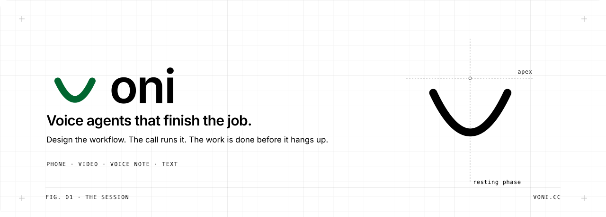
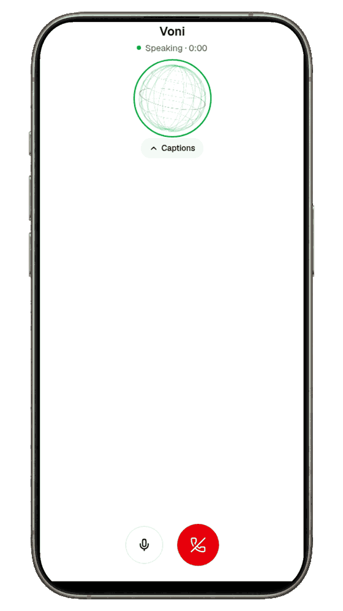
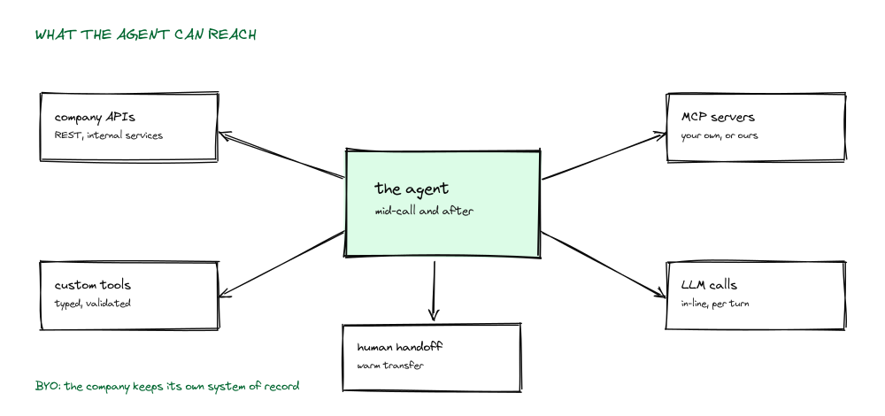
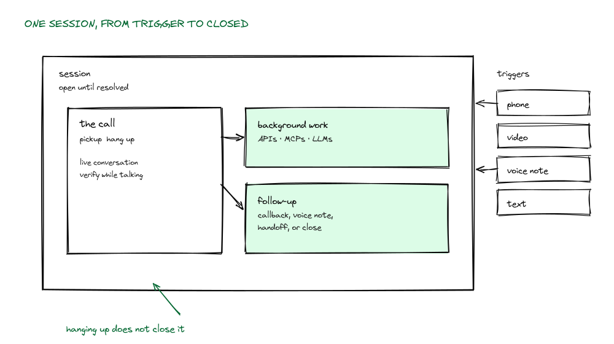
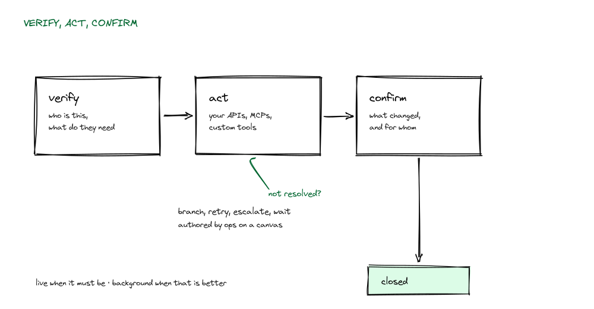
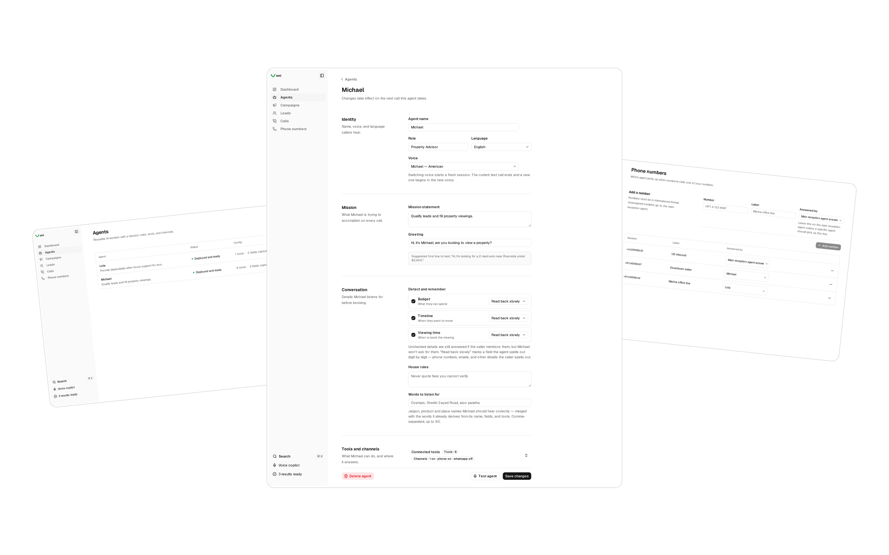
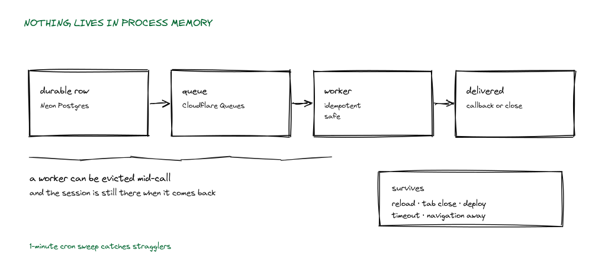
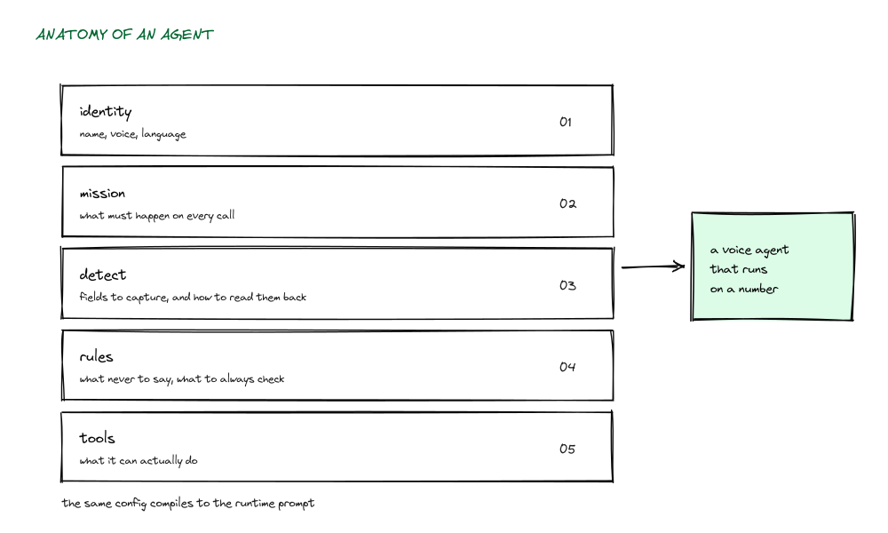
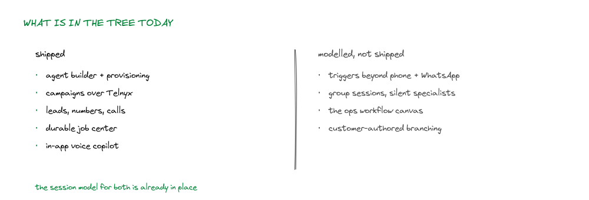

<p align="center">
  <picture>
    <source media="(prefers-color-scheme: dark)" srcset="docs/readme/assets/b-banner-dark.svg">
    
  </picture>
</p>

<br>

<h3 align="center">A platform for voice agents that run real business workflows over the phone,<br>and stay attached to the case until it closes.</h3>

<br>

<p align="center">
  <a href="https://github.com/cipherlogs/voni/actions/workflows/ci.yml"></a>
  <a href="#architecture"></a>
  <a href="https://voni.cc"></a>
</p>

<br>

<p align="center">
  <a href="docs/readme/assets/demo-call.mp4"><picture>
    <source type="image/webp" srcset="docs/readme/assets/demo-call.webp">
    
  </picture></a>
</p>

<p align="center">
  <sub><b>A real call, recorded from the landing page.</b> Voni answers and transcribes the caller in the browser. No app install.</sub>
</p>

<br>

Most voice agents answer questions. Voni agents verify the caller, call the company's own APIs and MCP servers, branch on the outcome, and keep working after the call ends when the job needs it.

**Design once. Trigger from anywhere. One session until resolved.**

<br>

## How it works

<br>

Three ideas carry the whole model.

<br>

<p align="center">
  <picture>
    <source media="(prefers-color-scheme: dark)" srcset="docs/readme/assets/figures/fig-04-tools-dark.svg">
    
  </picture>
</p>

**The trigger is not the workflow.** A phone call, a video call, a voice note, or a text message all open the same kind of session. Channels are transports, not separate products. Nothing in the workflow has to know how it was reached.

**A session is a durable object, not a call.** Calls end. Sessions don't. When the conversation goes quiet, the session's remaining work moves to a durable job queue: Neon holds the row, Cloudflare Queues carries the work, a one-minute cron sweep catches stragglers. When there's something to say, the agent calls back or leaves a voice note on the same record.

**Execution is the point.** The agent can use the company's tools mid-conversation and after it: REST APIs, MCP servers, custom functions, LLM calls. The loop is `verify → act → confirm`, and the confirm step writes an attributable record of what changed.

<br>

<p align="center">
  <picture>
    <source media="(prefers-color-scheme: dark)" srcset="docs/readme/assets/figures/fig-01-session-dark.svg">
    
  </picture>
</p>

<p align="center">
  <sub>The call is a window inside the session. Hanging up is not the same as closing the case.</sub>
</p>

<br>

<p align="center">
  <picture>
    <source media="(prefers-color-scheme: dark)" srcset="docs/readme/assets/figures/fig-02-loop-dark.svg">
    
  </picture>
</p>

<p align="center">
  <sub>The same loop for freezing a card and for dispatching a unit. Only the tools differ.</sub>
</p>

<br>

## Features

<br>

<p align="center">
  <picture>
    <source media="(prefers-color-scheme: dark)" srcset="docs/readme/assets/features-dark.png">
    
  </picture>
</p>

**Agent workspace.** Identity, voice, mission, greeting, and the exact fields the agent listens for before it books. Everything the agent is allowed to do is visible and editable on one page, not a prompt buried in a config file.

**Agents as reusable workers.** A list of every agent in the workspace with its deployed state, tool count, and channels. One agent can answer inbound, another can chase renewals; the workflow decides which one runs.

**Phone numbers.** Inbound lines, each mapped to the voice that picks up, or left on the main reception agent so an unassigned line still gets answered.

**Durable jobs.** Anything that outlives a call becomes a job with a row in Postgres: visible in the dashboard, retryable, and still there after a worker eviction.

<br>

## Phone numbers

<br>

A number in Voni is an inbound destination bound to one agent. Callers dial it, the agent answers, and the call becomes a session with its own record.

- **Buy and rent numbers in-product.** Search a country, pick a local or toll-free number, and assign it to an agent without leaving the dashboard
- **Worldwide coverage.** Numbers from many countries, with each prefix's own per-minute rate shown before you commit
- **Credits instead of invoices.** Top up a balance once. Calls, numbers, and monthly line rental draw from it, and every charge is itemised on the number it belongs to
- **Every line has an owner.** Bind a number to a specific agent, or leave it on the main reception agent so unassigned inbound still gets answered

<br>

## Architecture

<br>

<p>
  <picture>
    <source media="(prefers-color-scheme: dark)" srcset="docs/readme/assets/built-on-dark.svg">
    
  </picture>
</p>

<p align="center">
  <picture>
    <source media="(prefers-color-scheme: dark)" srcset="docs/readme/assets/figures/fig-03-durable-dark.svg">
    
  </picture>
</p>

<p align="center">
  <sub>Nothing important lives in process memory. A worker can be evicted mid-call and the session survives.</sub>
</p>

<br>

The app is a Next.js App Router deployment on Cloudflare Workers via OpenNext. Postgres (Neon, over HTTP) is the system of record for everything durable: sessions, jobs, leads, calls. Cloudflare Queues carries background work with an R2 bucket for staging and a cron trigger for recovery. Telephony media streams terminate in a small Python bridge that republishes audio into the voice pipeline.

<br>

### Anatomy and scope

<br>

<p align="center">
  <picture>
    <source media="(prefers-color-scheme: dark)" srcset="docs/readme/assets/figures/fig-05-anatomy-dark.svg">
    
  </picture>
</p>

<p align="center">
  <picture>
    <source media="(prefers-color-scheme: dark)" srcset="docs/readme/assets/figures/fig-06-scope-dark.svg">
    
  </picture>
</p>

<br>

## Getting started

<br>

```bash
git clone git@github.com:cipherlogs/voni.git
cd voni/voni      # the app lives in a subdirectory
npm install
npm run dev
```

Open <http://localhost:3000>.

<br>

## Environment

<br>

`DATABASE_URL` is not optional. The root layout resolves a session on every request, so without a database the landing page and dashboard both fail rather than degrade.

Minimum to boot and reach the dashboard:

```bash
DATABASE_URL=postgres://...
BETTER_AUTH_SECRET=...
BETTER_AUTH_URL=http://localhost:3000
```

Google OAuth (`GOOGLE_CLIENT_ID`, `GOOGLE_CLIENT_SECRET`) is required for real sign-in. Access is gated by an allowlist; for local work set `DEV_BYPASS_AUTH=true` in a non-production build to get a synthetic session.

Voice and telephony degrade silently rather than crash when their keys are absent:

```bash
ASSEMBLYAI_API_KEY=       # voice agents and streaming STT
TELNYX_API_KEY=           # numbers and outbound dialing
AI_GATEWAY_API_KEY=       # LLM judge, falls back to heuristics
```

The full variable list, including Worker-runtime overrides, is in `voni/ENVIRONMENT.md`. Nothing in `.env.local`, `.dev.vars`, or `certificates/` is ever committed.

<br>

## Commands

<br>

| Command | Description |
|---|---|
| `npm run dev` | Development server on :3000 |
| `npm run dev:phone` | HTTPS dev server for testing mic access from a phone |
| `npm run build` | Production build |
| `npm run preview` | OpenNext build, then local Workers preview |
| `npm run deploy` | OpenNext build, then `wrangler deploy` |
| `npm run typecheck` | `next typegen`, then `tsc --noEmit` |
| `npm run lint` | ESLint |
| `npm test` | App manifest check plus every `*.test.ts(x)` under `src/` and `scripts/` |
| `npm run test:e2e` | Full Playwright suite |
| `npm run db:generate` | Generate Drizzle migration |
| `npm run db:migrate` | Apply migrations |
| `npm run db:studio` | Drizzle Studio |
| `npm run db:seed` | Seed deterministic development data |

`npm run typecheck` is not the same as `tsc --noEmit`. `next typegen` generates route types (`PageProps`, `LayoutProps`, `RouteContext`) into `.next/types`, and a fresh checkout does not have them.

<br>

## Project layout

<br>

```
voni/
  src/app/           routes: public landing, auth, and the (dashboard) group
  src/lib/agents/    agent wizard, compile, provision, voices
  src/lib/voice/     session cascade, playout, barge-in, call marks, judges
  src/lib/jobs/      queue producer, processor, store, sweep
  src/lib/tools/     tool definitions and execution
  src/lib/copilot/   manifest, UI actuation, record tools
  drizzle/           SQL migrations (drizzle-kit)
telephony-bot/       Telnyx media-stream bridge and campaign runner (Python)
voice-pipeline/      streaming voice service
docs/                specs, ADRs, plans
```

<br>

## Testing

<br>

Unit tests use `node:test` and are auto-discovered. Add a `*.test.ts` file next to the code, not an entry in a config. Playwright covers the browser paths in `tests/e2e/`.

```bash
npm test                       # unit
npm run test:e2e               # all e2e
npm run test:e2e:instant       # instant-navigation contract only
```

Some integration scripts require a live database and provider keys; they run from `.env.local` via `node --env-file=.env.local`.

<br>

## Contributing

<br>

`AGENTS.md` is the contract, not a suggestion. It sets the async-work rule: anything that may take over three seconds is a durable job, not a spinner. It sets the visual-feedback rule: every async trigger shows pending, success, and failure. It also sets the page conventions for loading and error boundaries.

Before opening a pull request:

```bash
npm run typecheck && npm test && npm run lint
```

CI runs typecheck and lint on every push and pull request; keep the tree green.

<br>

## License

<br>

Source-available. All rights reserved. The source is published for reference, and no license is granted to use, copy, modify, or redistribute it. Contact the maintainers for terms.

<br>

<p align="center">
  <sub>Built by <a href="https://pilotxstudio.com">PilotX Studio</a> · <a href="https://voni.cc">voni.cc</a></sub>
</p>
